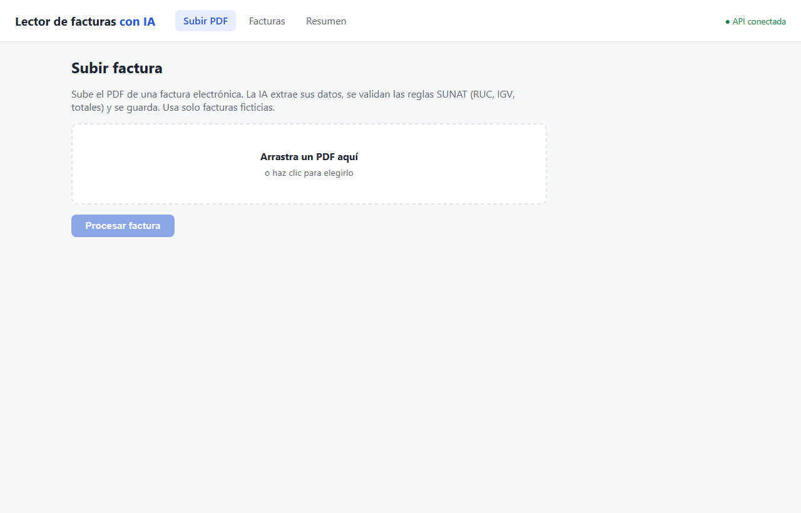
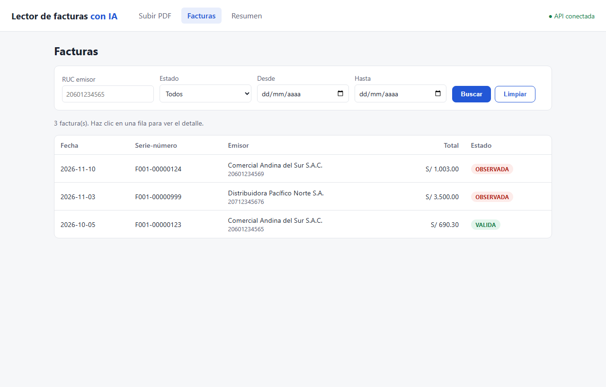
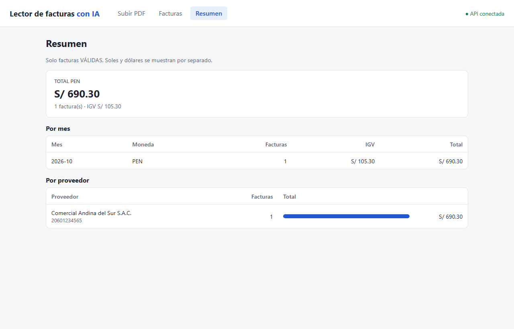
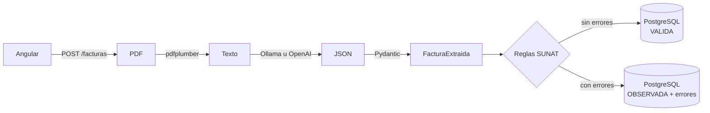

# Lector de facturas con IA


Aplicación full stack que recibe **facturas electrónicas peruanas en PDF**, extrae sus datos con un
modelo de IA, los **valida con reglas contables de SUNAT** y los guarda en PostgreSQL para consultarlos
y resumirlos. Backend en **FastAPI** y frontend en **Angular**.

| Subir PDF | Facturas | Resumen |
|---|---|---|
|  |  |  |

> Todas las facturas del repositorio son **ficticias** (RUC y empresas inventadas), generadas con
> `scripts/generar_facturas.py`.

## El problema

Registrar facturas de proveedores a mano es lento y propenso a errores: un IGV mal calculado
o un RUC mal escrito pasan desapercibidos. Esta API automatiza la lectura y, sobre todo,
**no confía ciegamente en la IA**: cada factura pasa por validaciones deterministas y, si algo
no cuadra, queda marcada como `OBSERVADA` con la lista de errores para revisión humana.

## Cómo funciona



1. **Texto**: `pdfplumber` extrae el texto del PDF (si no tiene texto → `400`).
2. **IA**: el modelo devuelve JSON restringido al esquema de Pydantic, con temperatura 0.
   Se le pide copiar los valores *sin corregirlos*, para que las validaciones detecten errores reales.
3. **Validación de forma** (Pydantic): tipos, fechas, moneda `PEN`/`USD`, montos ≥ 0.
4. **Validación contable** (`app/validaciones.py`), que reúne **todos** los errores, no solo el primero:
   - RUC de 11 dígitos con **dígito verificador** válido (algoritmo módulo 11 de SUNAT)
   - IGV ≈ 18 % del subtotal (tolerancia ±0.05 por redondeo)
   - subtotal + IGV = total
   - la suma de los ítems = subtotal
   - fecha de emisión no futura
5. **Duplicados**: misma combinación RUC + serie-número → `409 Conflict` (también protegido por un
   `UNIQUE` en la base, por si llegan dos peticiones a la vez).

## Endpoints

| Método | Ruta | Descripción |
|---|---|---|
| `POST` | `/facturas` | Sube un PDF (`multipart/form-data`, campo `archivo`) |
| `GET` | `/facturas` | Lista con filtros opcionales: `ruc`, `estado`, `desde`, `hasta` |
| `GET` | `/facturas/{id}` | Detalle con ítems |
| `GET` | `/resumen` | Total e IGV por mes y por proveedor (solo `VALIDA`, separado por moneda) |
| `GET` | `/salud` | Health check |

Documentación interactiva (Swagger) en `http://127.0.0.1:8000/docs`.

### Ejemplo

```bash
curl -F "archivo=@facturas_ejemplo/factura_03_igv_incorrecto.pdf" http://127.0.0.1:8000/facturas
```

```json
{
  "ruc_emisor": "20712345676",
  "razon_social": "Distribuidora Pacífico Norte S.A.",
  "serie_numero": "F001-00000999",
  "fecha_emision": "2026-11-03",
  "moneda": "PEN",
  "subtotal": "3000.00",
  "igv": "500.00",
  "total": "3500.00",
  "items": [
    { "descripcion": "Servicio de auditoría", "cantidad": "1.000", "precio_unitario": "3000.00", "id": 1 }
  ],
  "id": 1,
  "estado": "OBSERVADA",
  "errores": ["IGV 500.00 no coincide con el 18 % de 3000.00 (540.00)"],
  "creado_en": "2026-11-15T19:20:11.512Z"
}
```

## Interfaz web (Angular)

Carpeta `frontend/`, Angular 20 con componentes standalone y signals:

- **Subir PDF**: arrastrar o elegir un PDF; muestra el resultado (`VALIDA`/`OBSERVADA`), las
  observaciones de validación, los ítems y los totales. Los errores de la API (`409` duplicada,
  `400` PDF sin texto, `502` IA no disponible) se muestran con el mensaje que envía FastAPI.
- **Facturas**: tabla con filtros por RUC, estado y rango de fechas (se filtra en la API, no en el
  navegador) y detalle al hacer clic en una fila.
- **Resumen**: totales por moneda, por mes y por proveedor, con barras proporcionales.

Detalles de implementación:

- Un único `FacturasService` habla con la API; los componentes nunca arman URLs.
- Interfaces TypeScript que reflejan los esquemas Pydantic. Los montos llegan como `string`
  (la API usa `Decimal`) para no perder céntimos con los decimales de JavaScript.
- `FacturaDetalle` es un componente presentacional (`input()`) reutilizado en dos pantallas.
- Rutas con carga diferida (`loadComponent`).
- La API solo acepta peticiones del navegador desde los orígenes de `CORS_ORIGENES`.

## Cómo ejecutarlo

Requisitos: **Docker** y **[Ollama](https://ollama.com)** con el modelo `qwen2.5:3b`.

```bash
ollama pull qwen2.5:3b
docker compose up --build
```

Abrir `http://127.0.0.1:8000/docs`. Los PDFs de prueba están en `facturas_ejemplo/`.

Frontend (requiere Node 22 o superior), en otra terminal:

```bash
cd frontend
npm install
npx ng serve -o        # http://localhost:4200
```

> En carpetas sincronizadas (OneDrive) puede que Angular no detecte los cambios; usar
> `npx ng serve -o --poll 2000`.

Para usar OpenAI en vez de Ollama, copiar `.env.example` a `.env` y definir
`IA_PROVEEDOR=openai` y `OPENAI_API_KEY`. El `.env` está en `.gitignore`.

### Desarrollo local (sin Docker para la API)

```bash
python -m venv .venv
.venv\Scripts\Activate.ps1          # Windows (PowerShell)
pip install -r requirements.txt
docker compose up -d db              # solo PostgreSQL
uvicorn app.main:app --reload
```

### Tests

```bash
pytest -v                      # backend
cd frontend && npm test        # frontend (Karma + Jasmine)
```

Los tests **no necesitan IA ni PostgreSQL**: usan un extractor falso (`ExtractorFalso`) inyectado con
`dependency_overrides` de FastAPI y SQLite en memoria. Los del frontend simulan la API con
`HttpTestingController`. GitHub Actions corre ambos en cada push, compila Angular y construye la imagen Docker.

## Decisiones técnicas

- **Extractor de IA intercambiable**: `ExtractorIA` es un `Protocol` con un único método
  `extraer(texto) -> FacturaExtraida`. Ollama y OpenAI lo implementan; la variable `IA_PROVEEDOR`
  elige cuál. Así los tests y el resto del código no dependen de ningún proveedor.
- **La IA extrae, el código valida**: las reglas contables son funciones puras y testeadas; no se le
  pide a la IA que "revise" la factura porque podría corregir valores en silencio.
- **`Decimal` para dinero**, nunca `float`.
- **Una factura inválida se guarda igual** (`OBSERVADA` + errores) en vez de rechazarse: en la vida
  real hay que registrarla y reclamar al proveedor, no perderla.
- **Resumen por RUC y por moneda**: se agrupa por RUC (validado) y no por razón social, porque la IA
  puede escribir el nombre con pequeñas diferencias; y no se suman soles con dólares.

## Limitaciones conocidas

- Solo PDFs con texto; **no hace OCR** de facturas escaneadas.
- El modelo local pequeño (`qwen2.5:3b`) puede tener imprecisiones menores
  (por ejemplo, omitir un punto en la razón social).
- El extractor de OpenAI está implementado y probado con mocks, pero **no se probó contra la API real**.
- Las tablas se crean con `create_all` al arrancar; en un proyecto más grande usaría migraciones (Alembic).
- Sin autenticación: es una aplicación de demostración local.
- El frontend tiene tests unitarios de componentes y del servicio, pero no tests end-to-end.

## Stack

**Backend:** Python 3.13 · FastAPI · Pydantic v2 · SQLAlchemy 2.0 · PostgreSQL 16 · pdfplumber ·
Ollama / OpenAI · pytest

**Frontend:** Angular 20 · TypeScript · RxJS · signals · formularios reactivos · Karma/Jasmine

**Infraestructura:** Docker Compose · GitHub Actions
